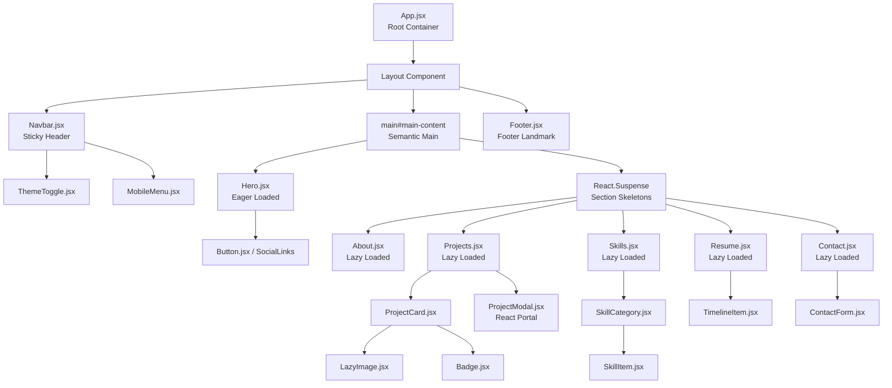
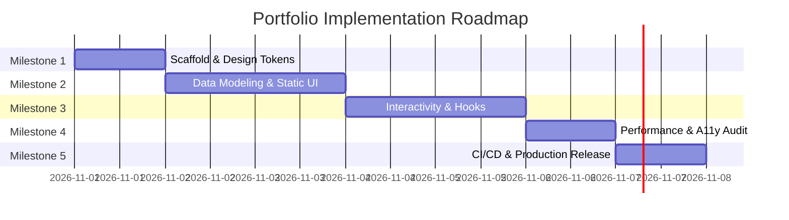

# 🏛️ Architecture Blueprint: React Personal Portfolio Website

**Role**: Principal Frontend Architect  
**Document Version**: 1.0.0  
**Status**: Approved for Implementation  
**Target Audience**: Senior Engineers, Technical Recruiters, Hiring Managers, Clients  

---

## 1. Requirements Analysis

### 1.1 Target Personas
- **Technical Recruiters & Sourcers**: Need instant access to seniority indicators, verified tech stack, contact channels, and downloadable PDF resume within 5 seconds.
- **Hiring Managers & Engineering Directors**: Evaluate code cleanliness, architectural rigor, system design trade-offs, and tangible project impact/metrics.
- **Direct Clients & Founders**: Seek problem-to-solution narrative, delivery reliability, conversion focus, and visual polish.
- **Peer Collaborators**: Review open-source contributions, repository links, code organization, and testing posture.

### 1.2 Core Sections
1. **Hero**: High-impact value proposition, availability beacon, seniority badge, core metrics, and high-conversion CTAs.
2. **About Me**: Professional trajectory, core engineering philosophy, domain focus, and architectural values.
3. **Projects**: Filterable showcase of commercial/open-source projects with outcome metrics, tech tags, live demos, repository links, and deep-dive modals.
4. **Skills**: Categorized competence matrix (Frontend, Architecture, Backend/Cloud, QA/Testing) with contextual proficiency indicators.
5. **Resume**: Interactive chronological career timeline, verified credentials, education, and 1-click CV download.
6. **Contact**: Accessible form with client-side validation, spam mitigation, direct contact vectors, and 1-click email copy.

### 1.3 Non-Functional Requirements (NFRs)
- **Performance**: First Contentful Paint (FCP) < 1.2s, Largest Contentful Paint (LCP) < 1.8s, Cumulative Layout Shift (CLS) < 0.02, Time to Interactive (TTI) < 2.0s on 4G mobile.
- **Responsiveness**: Fluid layout adaptation from 360px (mobile) to 1536px+ (ultrawide monitors).
- **Accessibility**: Strict WCAG 2.1 AA compliance (contrast ratios ≥ 4.5:1, full keyboard navigability, semantic landmark hierarchy, ARIA live regions).
- **SEO & Discoverability**: Lighthouse SEO score 100, Open Graph social cards, JSON-LD structured data (`Person`, `WebSite`).
- **Production Reliability**: Static edge distribution, 99.99% uptime, zero server maintenance overhead.

---

## 2. Tech Stack Decision & Justification

| Layer | Selection | Alternatives Considered | Architectural Justification |
| :--- | :--- | :--- | :--- |
| **Core Framework** | **React 19** | Vue 3, Svelte 5, Vanilla JS | Industry standard for hiring evaluations. React 19 provides native `ref` as prop, enhanced asset preloading, and server/client action primitives while maximizing ecosystem component reuse. |
| **Build Tooling** | **Vite 6+** | Create React App (CRA), Webpack | CRA is deprecated and dead. Vite leverages native ES Modules (ESM) and `esbuild` for <50ms hot module replacement (HMR) and Rollup/Rolldown for highly optimized production tree-shaking and chunking. |
| **Navigation Model** | **Single-Page Scroll Nav** | React Router (Multi-page) | A portfolio's primary objective is conversion. Multi-page routing introduces cognitive pauses and page transition overhead. Single-page smooth scroll provides an uninterrupted narrative flow, synchronized with `history.pushState` hash anchors (`#projects`, `#skills`) and `IntersectionObserver`. |
| **Styling Architecture** | **Tailwind CSS + CSS Variables** | CSS Modules, styled-components | `styled-components` incurs runtime CSS-in-JS overhead (~12kB parse/eval penalty) and style recalculation costs. Tailwind CSS compiles at build-time to a purged, atomic stylesheet (<8kB gzipped). Paired with CSS custom properties for instant, flash-free theme toggling (Dark/Light). |
| **State Management** | **React Built-in (`useState`, `useContext`)** | Redux Toolkit, Zustand, MobX | Architectural anti-pattern to introduce heavy external state stores for static/semi-static portfolio data. UI state is strictly local (active nav item, theme mode, modal open/close, form submission status). Custom hooks provide complete encapsulation without bundle bloat. |
| **Form Handling** | **Formspree (Serverless REST)** | EmailJS, Custom Node/Express API | Custom backend requires infrastructure maintenance, cold starts, and hosting costs. EmailJS exposes client-side keys and SDK overhead. Formspree offers a zero-maintenance serverless endpoint with built-in reCAPTCHA, honeypot spam protection, and direct webhook routing to email. |
| **Icons & Assets** | **Lucide React (Tree-shaken)** | FontAwesome, React Icons | Lucide provides lightweight, SVG-native, accessible icons with strict tree-shaking support, avoiding bundle contamination. |
| **Testing Engine** | **Vitest + React Testing Library** | Jest, Cypress | Vitest shares the identical Vite pipeline, config, and transform graph, executing component test suites 10x faster than Jest without Babel transpilation overhead. |

---

## 3. Folder Structure

A **feature-and-domain-driven structure** isolating reusable UI primitives, section containers, static data models, and custom hooks:

```text
portfolio/
├── .github/
│   └── workflows/
│       └── deploy.yml              # CI/CD pipeline for linting, testing, and deployment
├── public/
│   ├── favicon.svg                 # Scalable vector favicon
│   ├── favicon.ico                 # Fallback legacy favicon
│   ├── apple-touch-icon.png        # iOS home screen icon
│   ├── og-image.png                # Open Graph preview card (1200x630px)
│   ├── robots.txt                  # Search crawler directives
│   └── sitemap.xml                 # Search engine URL map
├── src/
│   ├── assets/
│   │   ├── docs/
│   │   │   └── resume.pdf          # Optimized downloadable executive CV
│   │   ├── icons/
│   │   │   └── brand-icons.jsx     # Custom SVG vectors for GitHub, LinkedIn, X
│   │   └── images/
│   │       ├── avatar.webp         # Profile portrait (WebP/AVIF multi-res)
│   │       └── projects/           # Optimized project preview thumbnails
│   │           ├── shopkart.webp
│   │           ├── eventora.webp
│   │           └── habitly.webp
│   ├── components/                 # Atomic, reusable UI primitives
│   │   ├── common/
│   │   │   ├── Badge.jsx           # Tech stack and status pill
│   │   │   ├── Button.jsx          # Polymorphic button/link with loading states
│   │   │   ├── Card.jsx            # Glassmorphism container wrapper
│   │   │   └── Skeleton.jsx        # Suspense layout placeholder
│   │   ├── layout/
│   │   │   ├── Navbar.jsx          # Responsive sticky navigation bar
│   │   │   ├── Footer.jsx          # Copyright, sitemap links, and social vectors
│   │   │   ├── MobileMenu.jsx      # Slide-out drawer with focus trap
│   │   │   └── ThemeToggle.jsx     # Dark/Light mode toggle switch
│   │   ├── media/
│   │   │   └── LazyImage.jsx       # IntersectionObserver image loader with blur-up
│   │   └── modal/
│   │       └── ProjectModal.jsx    # Accessible modal dialog with focus restoration
│   ├── data/                       # Strongly-typed static data models
│   │   ├── navigationData.js       # Nav items, anchors, and social links
│   │   ├── personalData.js         # Bio, title, contact metadata, metrics
│   │   ├── projectsData.js         # Projects schema instances
│   │   ├── resumeData.js           # Career history, credentials, education
│   │   └── skillsData.js           # Skills categorizations and proficiencies
│   ├── hooks/                      # Custom encapsulated React hooks
│   │   ├── useActiveSection.js     # IntersectionObserver scroll spy
│   │   ├── useForm.js              # Form validation and submission state
│   │   ├── useKeyboardTrap.js      # Modal focus trapping and Esc handling
│   │   ├── useScrollDirection.js   # Dynamic navbar hide/show on scroll
│   │   └── useTheme.js             # Theme persistence and system preference sync
│   ├── sections/                   # Page section components (lazy-loaded)
│   │   ├── Hero.jsx                # Above-the-fold high-conversion introduction
│   │   ├── About.jsx               # Bio, philosophies, and milestone strip
│   │   ├── Projects.jsx            # Filterable project showcase grid
│   │   ├── Skills.jsx              # Categorized skills matrix
│   │   ├── Resume.jsx              # Timeline experience and education
│   │   └── Contact.jsx             # Client inquiry form and direct contacts
│   ├── styles/                     # Global styling system
│   │   ├── index.css               # Tailwind directives and resets
│   │   ├── tokens.css              # Design tokens (colors, spacing, shadows)
│   │   └── animations.css          # Keyframes for gradient shifts, shimmers
│   ├── utils/                      # Pure utility functions
│   │   ├── analytics.js            # Privacy-focused telemetry/event tracker
│   │   ├── formatters.js           # Date and metric formatters
│   │   ├── schemaGenerator.js      # JSON-LD schema builder
│   │   └── validators.js           # Email and input sanitization helpers
│   ├── App.jsx                     # Root application coordinator
│   └── main.jsx                    # React 19 DOM bootstrap
├── index.html                      # HTML5 shell with meta tags & preconnects
├── package.json                    # Project dependencies and script declarations
├── postcss.config.js               # PostCSS configuration for Tailwind
├── tailwind.config.js              # Theme extension, dark mode class, tokens
├── vercel.json                     # Edge cache headers and SPA routing
└── vite.config.js                  # Rollup chunking, plugins, Vitest config
```

---

## 4. Component Hierarchy & Data Flow

### 4.1 Visual Hierarchy Diagram



### 4.2 Component Props & Data Flow Specification

| Component | Inbound Props / State | Outbound Events / Actions | Downstream Children |
| :--- | :--- | :--- | :--- |
| **`App`** | State: `theme`, `activeSection`, `selectedProject` | Orchestrates context and modal portal | `Navbar`, `Main`, `Footer`, `ProjectModal` |
| **`Navbar`** | `activeSection: string`, `theme: string`, `navLinks: NavItem[]` | `onToggleTheme()`, `onNavigate(hash)` | `ThemeToggle`, `MobileMenu` |
| **`Hero`** | `personalData: PersonalInfo` | `onCtaClick(targetSection)` | `Button`, `Badge` |
| **`About`** | `aboutData: AboutSection` | None (Informational) | `Card`, `Badge` |
| **`Projects`** | `projects: Project[]`, `activeFilter: string` | `onSelectProject(project)`, `onFilterChange(tag)` | `ProjectCard`, `Badge`, `LazyImage` |
| **`ProjectModal`** | `project: Project | null`, `isOpen: boolean` | `onClose()`, `onKeyDown(Esc)` | `Badge`, `Button`, `LazyImage` |
| **`Skills`** | `skills: SkillCategoryGroup[]`, `activeCategory: string` | `onSelectCategory(category)` | `SkillCategory`, `Badge` |
| **`Resume`** | `experiences: Experience[]`, `education: Education[]` | `onDownloadResume()` | `TimelineItem`, `Button` |
| **`Contact`** | `contactInfo: ContactData` | `onSubmit(formData)` via `useForm` | `Button`, `Card` |
| **`Footer`** | `socialLinks: SocialLink[]`, `siteMeta: SiteMeta` | None | `brand-icons` |

---

## 5. Data Modeling & Schemas

### 5.1 Storage Strategy
**Decision: Static TypeScript Definition Files (`src/data/*.ts`)**
- **Justification**: A portfolio is authored exclusively by the developer. Static TypeScript files eliminate external API latency (0ms TTFB), provide compile-time type validation, ensure 100% offline availability in development, and eliminate external CMS subscription costs or API quota restrictions.
- **Scalability Path**: If dynamic client testimonials or weekly blog posts are introduced in the future, the schema interfaces remain identical, enabling drop-in migration to Sanity or Contentful.

### 5.2 TypeScript Interfaces

```typescript
// src/data/types.ts

export type ProjectTag = 
  | 'React' | 'TypeScript' | 'Node.js' | 'Tailwind CSS' 
  | 'Next.js' | 'Vitest' | 'GraphQL' | 'PostgreSQL' | 'Docker';

export interface ProjectImage {
  src: string;          // Fallback PNG/JPG
  webp: string;         // Modern WebP asset
  avif?: string;        // Ultra-compressed AVIF asset
  alt: string;          // WCAG descriptive alternative text
  width: number;        // Prevent layout shift
  height: number;
}

export interface Project {
  id: string;
  title: string;
  slug: string;
  tagline: string;
  description: string;
  longDescription: string;
  tags: ProjectTag[];
  image: ProjectImage;
  liveUrl: string;
  repoUrl: string;
  featured: boolean;
  order: number;
  metrics: {
    label: string;
    value: string;
  }[];
  architecturalHighlights: string[];
}

export type SkillCategory = 
  | 'Frontend & Architecture' 
  | 'Backend & Cloud' 
  | 'Testing & QA' 
  | 'Tooling & DevOps';

export interface Skill {
  name: string;
  category: SkillCategory;
  proficiency: number;  // 1 to 100 scale for visual gauge
  level: 'Intermediate' | 'Advanced' | 'Expert';
  icon: string;         // Lucide icon name or SVG path
  yearsOfExperience: number;
  featured: boolean;
}

export interface Experience {
  id: string;
  role: string;
  company: string;
  location: string;
  period: {
    start: string;      // e.g., "2021"
    end: string | 'Present';
  };
  summary: string;
  achievements: string[];
  technologies: ProjectTag[];
}
```

---

## 6. Responsive Design Strategy

### 6.1 Breakpoint System (Mobile-First)

The architecture standardizes on a 5-tier fluid breakpoint token system aligned with modern device viewports:

| Token | Min Width | Target Devices | Layout Behavior |
| :--- | :--- | :--- | :--- |
| **`xs`** | `360px` | Small smartphones (iPhone SE, Galaxy A) | Single column, stacked cards, full-width buttons, collapsed drawer menu |
| **`sm`** | `640px` | Large smartphones, mini tablets | 1-2 column metrics, expanded padding, horizontal button pairs |
| **`md`** | `768px` | Tablets portrait (iPad), foldable phones | 2-column project grid, visible inline navigation links, side-by-side bio |
| **`lg`** | `1024px` | Tablets landscape, laptops | 3-column project grid, sticky sidebar navigation option, dual-column contact |
| **`xl`** | `1280px` | Standard desktop monitors | Max-width container (`1200px`), optimized reading line length (65-75ch) |
| **`2xl`**| `1536px` | Ultrawide displays, 4K monitors | Centered container (`1440px` clamp) with ambient decorative glow borders |

### 6.2 Layout Primitives: CSS Grid vs Flexbox
- **CSS Grid**: Enforced for multi-dimensional macro-layouts requiring uniform row and column distribution without layout shifts:
  ```css
  /* Responsive Project Matrix */
  .project-grid {
    display: grid;
    grid-template-columns: repeat(auto-fill, minmax(min(100%, 340px), 1fr));
    gap: 1.5rem;
  }
  ```
- **Flexbox**: Enforced for one-dimensional micro-components (Navbar alignment, pill badges, button icon-text pairings, footer social arrays).

### 6.3 Image Responsiveness Strategy
To eliminate layout shifts (CLS = 0) and optimize cellular bandwidth, images utilize the HTML5 `<picture>` element with intrinsic aspect ratio clamping:

```html
<picture>
  <source type="image/avif" srcset="/images/projects/app-400.avif 400w, /images/projects/app-800.avif 800w" sizes="(max-width: 768px) 100vw, 50vw" />
  <source type="image/webp" srcset="/images/projects/app-400.webp 400w, /images/projects/app-800.webp 800w" sizes="(max-width: 768px) 100vw, 50vw" />
  
</picture>
```

---

## 7. Performance & Optimization Plan

### 7.1 Code-Splitting Boundaries
- **Eager Critical Path**: `Navbar` and `Hero` are bundled into the entry chunk. The above-the-fold canvas renders immediately without secondary network waterfalls.
- **Lazy Boundaries (`React.lazy` + `Suspense`)**: Below-the-fold sections are decoupled into discrete chunks loaded on demand:
  ```javascript
  // src/App.jsx
  import { lazy, Suspense } from 'react';
  import Navbar from './components/layout/Navbar';
  import Hero from './sections/Hero';
  import SectionSkeleton from './components/common/Skeleton';

  const About = lazy(() => import('./sections/About'));
  const Projects = lazy(() => import('./sections/Projects'));
  const Skills = lazy(() => import('./sections/Skills'));
  const Resume = lazy(() => import('./sections/Resume'));
  const Contact = lazy(() => import('./sections/Contact'));
  ```
- **Skeleton Shimmer Placeholders**: Each `Suspense` boundary renders a structural skeleton reserving identical CSS height/width to guarantee CLS < 0.01.

### 7.2 Image & Asset Pipeline
1. **Format Conversion**: All raster graphics are pre-converted to WebP and AVIF (yielding 30-50% size reductions over standard PNG/JPG).
2. **Above-the-Fold Prioritization**: The Hero avatar explicitly sets `loading="eager"` and `fetchpriority="high"`, accompanied by `<link rel="preload">` in `index.html`.
3. **Below-the-Fold Lazy Loading**: Handled via `loading="lazy"` and native `IntersectionObserver` in `LazyImage.jsx`.
4. **Font Optimization**: Google Fonts (*Outfit*, *Inter*) loaded via `preconnect` hints with `font-display: swap` to prevent Flash of Invisible Text (FOIT).

### 7.3 Vite Rollup Chunking & Bundle Budget

```javascript
// vite.config.js snippet
export default defineConfig({
  build: {
    target: 'es2022',
    cssCodeSplit: true,
    rollupOptions: {
      output: {
        manualChunks: {
          'vendor-react': ['react', 'react-dom'],
          'vendor-icons': ['lucide-react']
        }
      }
    }
  }
});
```

- **Performance Budgets**:
  - Critical JS Entry: `< 45 kB` (gzipped)
  - Critical CSS: `< 8 kB` (gzipped)
  - Total Initial Page Weight: `< 180 kB`
  - Automated analysis via `rollup-plugin-visualizer` generating `dist/stats.html` on each production build.

---

## 8. Accessibility Plan (WCAG 2.1 AA)

### 8.1 Semantic Landmarks & Hierarchy
- Strict single `<h1>` on the page inside `Hero` declaring developer identity and specialization.
- Proper semantic hierarchy: `<header>`, `<nav>`, `<main id="main-content">`, `<section aria-labelledby="section-heading-id">`, `<footer>`.
- Permanent "Skip to Main Content" bypass link placed as the first focusable element in DOM for keyboard and screen reader users:
  ```html
  <a href="#main-content" class="sr-only focus:not-sr-only focus:absolute focus:top-4 focus:left-4 focus:z-50 focus:p-3 focus:bg-accent focus:text-white">
    Skip to main content
  </a>
  ```

### 8.2 Keyboard Navigation & Focus Management
- Interactive elements (`button`, `a`, `input`, `textarea`) guarantee visible focus rings via `:focus-visible` with a distinct `2px` offset.
- `ProjectModal` implements an active **Focus Trap**: upon opening, focus moves to the modal header; pressing `Tab` cycles strictly inside the modal; pressing `Escape` dismisses the modal and restores focus to the invoking trigger button.
- Mobile drawer navigation locks body scroll (`overflow: hidden`) and traps focus while active.

### 8.3 Contrast & Color Ratios
- **Dark Mode**: Background `#0B0F19`, Card Surface `#111827`, Primary Text `#F9FAFB` (Contrast ratio 16.2:1).
- **Light Mode**: Background `#F8FAFC`, Card Surface `#FFFFFF`, Primary Text `#0F172A` (Contrast ratio 15.8:1).
- Interactive accents (#3B82F6 / #6366F1) exceed the minimum 4.5:1 ratio against their respective backdrops for all standard body and link text.

### 8.4 Form Accessibility
- Every input field pairs with an explicit `<label htmlFor="field-id">`.
- Real-time validation errors link via `aria-describedby="field-error-id"`.
- Form submission status announced to screen readers via an `aria-live="polite"` feedback banner.

---

## 9. SEO & Social Discoverability Plan

### 9.1 Meta & Open Graph Configuration (`index.html`)

```html
<!-- Primary Meta Tags -->
<title>Manas Maydeo — Senior Lead Web Developer & Frontend Architect</title>
<meta name="title" content="Manas Maydeo — Senior Lead Web Developer & Frontend Architect" />
<meta name="description" content="Portfolio of Senior Lead Web Developer with 12+ years building high-performance, conversion-driven web applications with React, Vite, and Cloud Native Architectures." />
<meta name="keywords" content="Frontend Architect, Senior React Developer, Web Performance, Vitest, JavaScript, TypeScript, UI/UX" />
<meta name="author" content="Manas Maydeo" />
<meta name="robots" content="index, follow" />
<link rel="canonical" href="https://manasmaydeo.dev/" />

<!-- Open Graph / Facebook / LinkedIn -->
<meta property="og:type" content="website" />
<meta property="og:url" content="https://manasmaydeo.dev/" />
<meta property="og:title" content="Manas Maydeo — Senior Lead Web Developer Portfolio" />
<meta property="og:description" content="Sub-second speed, intuitive design, and battle-tested engineering. Explore projects, architectural case studies, and credentials." />
<meta property="og:image" content="https://manasmaydeo.dev/og-image.png" />
<meta property="og:image:width" content="1200" />
<meta property="og:image:height" content="630" />

<!-- Twitter / X -->
<meta name="twitter:card" content="summary_large_image" />
<meta name="twitter:creator" content="@manasmaydeo" />
<meta name="twitter:title" content="Manas Maydeo — Senior Lead Web Developer" />
<meta name="twitter:description" content="Explore commercial case studies, test-driven React architectures, and senior web leadership experience." />
<meta name="twitter:image" content="https://manasmaydeo.dev/og-image.png" />
```

### 9.2 Structured Data (JSON-LD)

Embedded directly in `<head>` to feed Google Search Knowledge Graph and rich recruiter snippets:

```json
{
  "@context": "https://schema.org",
  "@graph": [
    {
      "@type": "Person",
      "@id": "https://manasmaydeo.dev/#person",
      "name": "Manas Maydeo",
      "jobTitle": "Senior Lead Web Developer & Frontend Architect",
      "url": "https://manasmaydeo.dev",
      "image": "https://manasmaydeo.dev/images/avatar.webp",
      "sameAs": [
        "https://github.com/manasmaydeo8",
        "https://linkedin.com/in/manasmaydeo"
      ],
      "knowsAbout": [
        "Frontend Architecture",
        "React",
        "TypeScript",
        "Web Performance Optimization",
        "Test Engineering",
        "Cloud Systems"
      ]
    },
    {
      "@type": "WebSite",
      "@id": "https://manasmaydeo.dev/#website",
      "url": "https://manasmaydeo.dev",
      "name": "Manas Maydeo Portfolio",
      "publisher": {
        "@id": "https://manasmaydeo.dev/#person"
      }
    }
  ]
}
```

---

## 10. Deployment & Hosting Plan

### 10.1 Target Platform: Vercel (Edge Network)
- **Selection**: Vercel Edge Network.
- **Justification**: Native Git-integrated CI/CD, automatic SSL provisioning, global anycast edge caching, atomic deployments with zero-downtime rollbacks, and instant branch preview URLs for pull requests.

### 10.2 Build Configuration & Headers

```json
// vercel.json
{
  "buildCommand": "npm run build",
  "outputDirectory": "dist",
  "cleanUrls": true,
  "headers": [
    {
      "source": "/assets/(.*)",
      "headers": [
        {
          "key": "Cache-Control",
          "value": "public, max-age=31536000, immutable"
        }
      ]
    },
    {
      "source": "/(.*)",
      "headers": [
        {
          "key": "X-Content-Type-Options",
          "value": "nosniff"
        },
        {
          "key": "X-Frame-Options",
          "value": "DENY"
        },
        {
          "key": "X-XSS-Protection",
          "value": "1; mode=block"
        },
        {
          "key": "Referrer-Policy",
          "value": "strict-origin-when-cross-origin"
        },
        {
          "key": "Permissions-Policy",
          "value": "camera=(), microphone=(), geolocation=()"
        }
      ]
    }
  ],
  "rewrites": [
    {
      "source": "/(.*)",
      "destination": "/index.html"
    }
  ]
}
```

### 10.3 Environment Variables
- `VITE_FORMSPREE_KEY`: Formspree endpoint identifier.
- `VITE_SITE_URL`: Canonical deployment origin (`https://manasmaydeo.dev`).
- `VITE_GA_TRACKING_ID`: Privacy-compliant Google Analytics 4 / Plausible telemetry token.

### 10.4 Custom Domain & SSL
- **DNS Records**:
  - Apex domain (`manasmaydeo.dev`): `A` record pointing to `76.76.21.21` (Vercel Anycast IP).
  - Subdomain (`www.manasmaydeo.dev`): `CNAME` record to `cname.vercel-dns.com` with auto 301-redirect to apex.
- **SSL/TLS**: Automated Let's Encrypt renewal with HSTS preload enforcement (`max-age=63072000`).

---

## 11. Development Roadmap & Milestones



| Milestone | Deliverables | Key Acceptance Criteria | Est. Effort |
| :--- | :--- | :--- | :--- |
| **M1: Foundation & Scaffold** | Initialize Vite + React 19 + Tailwind, configure Vitest, design token setup (`tokens.css`), typography preconnects. | `npm run build` & `npm run test` pass clean; base styles and font weights active. | 4-6 hrs |
| **M2: Data & Static Layouts** | Implement `src/data/*.ts`, construct semantic sections (`Hero`, `About`, `Projects`, `Skills`, `Resume`, `Footer`). | All sections render complete mock data with semantic HTML headings; responsive on 360px - 1440px. | 8-10 hrs |
| **M3: Interactivity & State** | Smooth scroll spy (`useActiveSection`), theme toggle (Dark/Light), Project modal portal, Formspree form submission with validation. | Modal focus traps correctly; form shows loading and success banner; active link tracks scroll position. | 6-8 hrs |
| **M4: Optimization & A11y** | Code splitting via `React.lazy`, AVIF/WebP image pipeline, WCAG 2.1 AA audit, JSON-LD schema, Open Graph tags. | Lighthouse performance score ≥ 95, accessibility score = 100, zero contrast warnings. | 4-6 hrs |
| **M5: Deployment & CI/CD** | GitHub Actions pipeline, Vercel edge deployment, security headers configuration, custom domain DNS verification. | Production URL live with HTTPS, automated previews on PR, sub-second global response time. | 3-4 hrs |
| **Total Project Effort** | | **Production-Ready Portfolio** | **25-34 hrs** |
